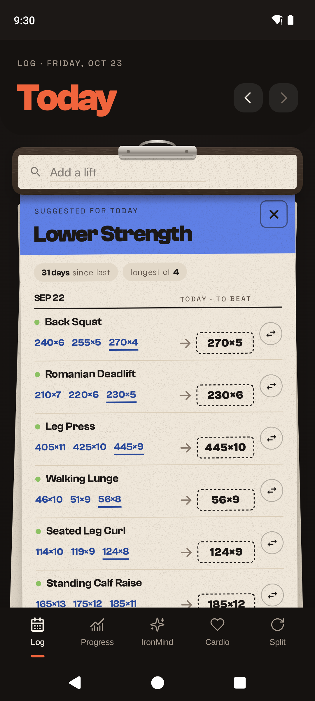
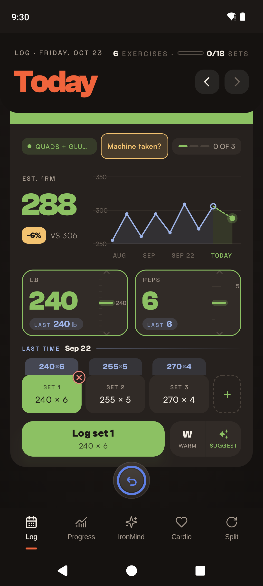
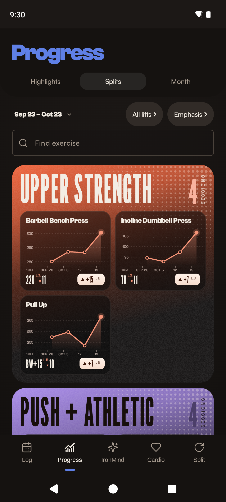
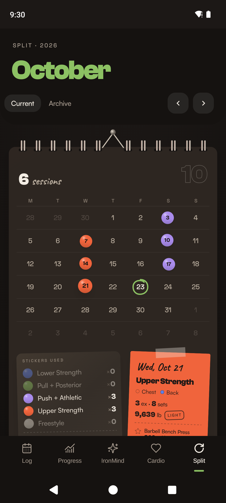
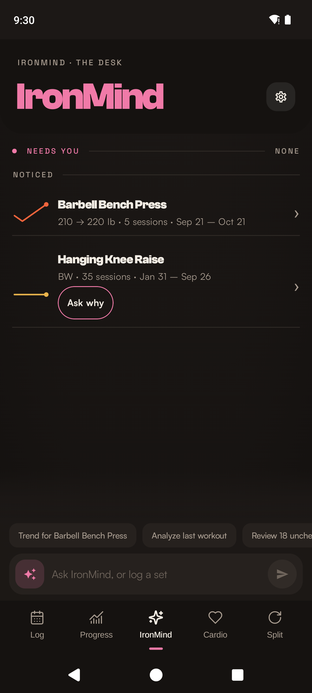
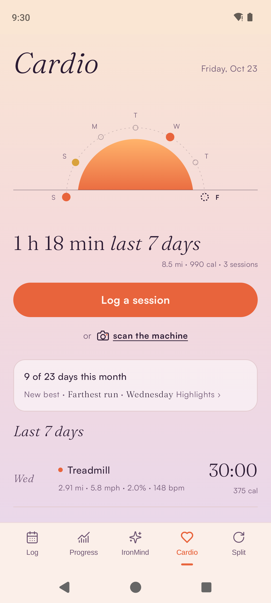

# EcoLift

[](https://github.com/AymanCode/AI-LIfting-App/actions/workflows/android-ci.yml)

EcoLift is a workout tracker for Android, with a web version I now use at the gym. I built
it because I was still going, but some of the excitement had gone. Logging had turned into
bookkeeping: the numbers went in and mostly disappeared.

I wanted recording a set to take seconds, previous workouts to be easy to find, and months
of training to build an encyclopedia of my workout history instead of a pile of rows.

This repository contains the Android app. The web version lives at
[AymanCode/ecolift-web](https://github.com/AymanCode/ecolift-web).

## Screenshots

Screenshots are from the Android app with demo data.

| Workout log | Set card |
| --- | --- |
|  |  |

| Progress | Split |
| --- | --- |
|  |  |

| IronMind | Cardio |
| --- | --- |
|  |  |

## What it does

The Android app shows the same screens as the web app: Log, Progress, IronMind, Cardio, and
Split. Room on the device stores the workouts. There is no account, no sync, and no offline
queue.

- Logs exercises, sets, reps, weights, completion state and rest time.
- Finds exercises without needing the name to be typed exactly as it was saved.
- Manages ordered training splits and suggests which session comes next.
- Has a Smart suggest switch on the Split tab. When it is on, Split shows learned splits.
  When it is off, Split shows only the splits you made. Edits to a split's lifts, their order
  and its other options survive restarts and backups.
- Shows exercise history, strength estimates, trends and previous sets.
- Saves finished training cycles as snapshots so later routine changes do not rewrite them.
- Gives each cardio activity its own fields, including incline, cadence, pace, stroke rate
  and floors.
- Backs up and restores workout data locally.
- Imports older notes written as `135x8`, `135 lb x 8`, `135 for 8 8 6` and similar formats.
- Includes an AI assistant called IronMind for corrections, imports and edits that are slow
  to do by hand.

## Why I built it this way

Logging should not interrupt the workout. The exercise I am doing gets the screen, the
buttons I need stay close, and previous weights are easy to reuse. A lot of the commit
history is small changes to spacing, wording and taps because those are the things I notice
between sets.

Progress should make small increases feel worth noticing. Five more pounds or one more rep
can look like nothing on its own. The progress screens connect that set to the rest of the
exercise history, and finished cycles get a recap instead of another page of loose stats.

I do not want an old workout to change because I edited the split I use now. A finished
cycle is stored as a snapshot. That choice reaches into migrations, backups and database
constraints because the history is part of the product, not leftover data.

I wanted AI in the app, but I did not want it in the way. Logging, splits, progress,
history, cardio, backups and search work without a model. IronMind is there when typing a
correction or cleaning up old notes would take longer than asking for it.

## How it started

The first version was two experiments at once. I wanted to see whether the small local
models I could run on my own hardware could build an app I would use, and whether I could
get an MVP onto my phone quickly. I had the first MVP on my phone after three days, then
kept changing it as I used it.

I tried Qwen models from roughly 3B to 9B through Aider and Continue. I started with the
whole project, then cut the scope to one file, one class and eventually one function at a
time. That helped, but larger models still had to repair too much of the output. The
local-only rule stopped making sense.

I stopped limiting the project to local models. I cared more about using the app than which
model made it. AI agents have written most of the code since. I decide what to build, what
gets kept, and what needs another pass when the app gets in my way during a workout.

## IronMind

IronMind is the AI assistant in EcoLift. It is for edits that are annoying to do by hand,
especially older corrections and imports:

- `yesterday calf raises 90 for 12 10 8`
- `for last saturday my deadlift top set should say three fifteen for four not 275`
- `delete the extra squat set from May 10`

Kotlin code handles each request first, and sending a message does not call a model. Try AI
on a failed draft calls Groq in a debug build with `GROQ_API_KEY` set, and Gemini Nano on API
31 and newer otherwise. The model never touches the database.

A delete or a rename waits in the chat with Apply and Cancel, and nothing is written until
you tap Apply. Other changes are saved right away. The most recent applied change offers Undo
from the chat, and that Undo is still there after you switch tabs and come back. Restoring a
backup clears any waiting change and the Undo. Restarting the app clears Undo history.

If an imported line or workout log cannot be parsed, EcoLift keeps the original text in an
editable draft instead of guessing. The prompt cases used to check this behavior live in
`src/test/resources/agent_eval`.

## Web version

The web app is a Kotlin/Wasm PWA built with Compose Multiplatform. I went with a PWA so I
could use EcoLift on iOS without maintaining another native app or putting each update
behind App Store review.

The browser version uses Supabase for sign-in and storage. Workout-set changes update the
screen first and wait in a per-user browser queue when the connection drops.

The web code lives at [AymanCode/ecolift-web](https://github.com/AymanCode/ecolift-web).
It is the version I use during workouts now.

## Running it

You need Android Studio or the Android SDK, JDK 17, minSdk 26, and compileSdk 36.

```bash
git clone https://github.com/AymanCode/AI-LIfting-App.git
cd AI-LIfting-App
./gradlew installDebug
```

On Windows use `gradlew.bat`. The APK is written to `build/outputs/apk/debug/`.

A Groq key is only used for debug builds and opt-in assistant evals. `build.gradle.kts`
reads `GROQ_API_KEY` from a Gradle property or from the environment. It does not open
`local.properties`. Release builds leave the key blank. Do not commit `local.properties`,
`.env`, model files or release signing files.

The checked-in `.android/debug.keystore` gives debug and CI builds the same certificate so
upgrade tests can install one build over another. It is not a release key.

## Testing

```bash
./gradlew testDebugUnitTest
./gradlew connectedDebugAndroidTest # needs a device or emulator
```

CI runs ktlint 1.5.0 over `src/**/*.kt`, then
`./gradlew testDebugUnitTest assembleDebug assembleDebugAndroidTest`. That builds the app
and the instrumentation-test APK. It does not run the instrumentation tests.
`scripts/ci/verify-apk-signer.sh` checks the debug APK against the pinned signer.
`scripts/ci/verify-apk-compatibility.sh` requires the same package and signer as an older
build, and a higher `versionCode`.

More commands are in [docs/TESTING.md](docs/TESTING.md).

## Layout

```text
src/main/java/com/ayman/ecolift
  agent/       IronMind routing, tools, patches, audit and undo
  ai/          exercise classification and the Groq client
  android/     RoomRepos, AndroidAppServices, and platform shims
  cardio/      cardio fields, parsers, and OCR result types
  data/        workout models and the calculations the screens use
  data/room/   Room entities, mapped to the web models
  ui/          web screens, navigation, theme, and view models
  web/         AppRepos, repository interfaces, and demo data

analytics/     DuckDB loader for backup exports
schemas/       exported Room schemas
docs/          architecture and testing notes
```

Good places to start are
[AgentOrchestrator.kt](src/main/java/com/ayman/ecolift/agent/AgentOrchestrator.kt) for an
IronMind request,
[Migrations.kt](src/main/java/com/ayman/ecolift/data/Migrations.kt) for schema changes, and
[LogViewModel.kt](src/main/java/com/ayman/ecolift/ui/viewmodel/LogViewModel.kt) for the log
screen's state.

More detail is in [docs/ARCHITECTURE.md](docs/ARCHITECTURE.md).

## License

Licensed under the [MIT License](LICENSE).
